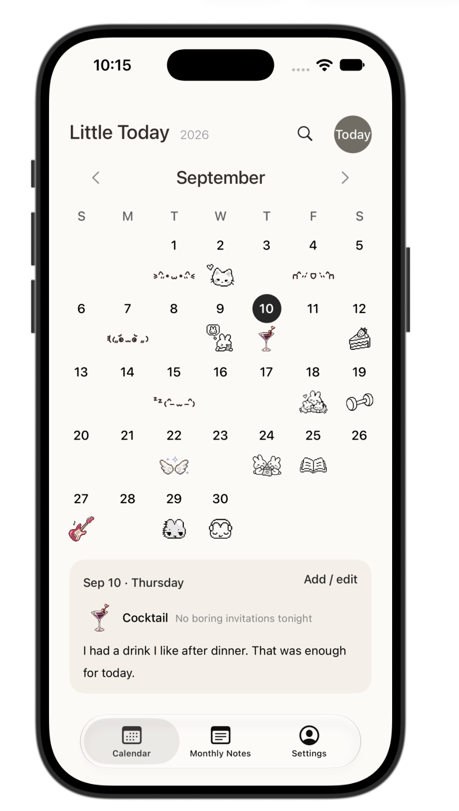
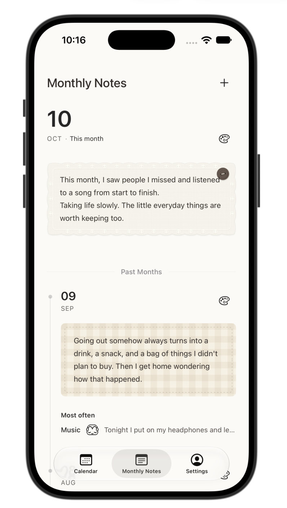

# Mood Calendar

首次使用先展示引导和版本介绍，不等待更新网络请求；两者关闭且 App 处于前台、没有 iCloud 错误提示时，延迟 450 毫秒开始自动更新检查。每个自然日最多执行一组检查（失败也计数），一组最多依次请求三次，任一次发现未忽略的新版本便立即停止并提示；全部未发现则保持安静。联网权限如需询问，由系统在网络访问时处理。引导轻微缩放淡入，并尊重减少动态效果设置。说明顺序为切换年份、手指滑动切换月份、记录今天；「知道了」使用贴合文字的胶囊按钮。

手动检查更新入口目前已在「我的」中注释隐藏，保留实现以便恢复；下文有关手动检查的说明描述保留的实现。自动更新检查继续启用。

A native iPhone and iPad mood calendar built with SwiftUI and SwiftData. You can create or edit one entry for today. Allow editing past days defaults to on in Personalization; past days show Edit for an existing entry and Add entry for an empty day. Turning it off makes past days read-only. Future dates are always read-only.

iPad runs natively in portrait, landscape and resizable windows, with layouts measured from the current window or sheet (`Features/Shared/AdaptiveLayout.swift`). Calendar uses the available width and equal-height tablet date rows; windows at least 1000 points wide show the selected-day detail beside the calendar. From 760 points, monthly notes place the current month above a two-column history grouped by year; windows at least 1000 points wide show current and historical months side by side. Settings uses two content columns from 760 points. Collections use full-width shelves, larger tablet thumbnails, adaptive photo columns and two-column media pages when space permits; each media page still contains at most six items. Entry editing uses two columns in forms at least 700 points wide. Narrow windows and accessibility text fall back to one column where needed. Search occupies 90% of the tablet window up to 900 points and follows the keyboard safe area. Limited-task modals retain readable widths and scroll where needed. iPhone retains its existing layout values, spacing and orientation settings.

The app has four tabs: Calendar, Monthly Note, Collection, and Settings. Settings lets you choose an accent color, a date and month selection marker, and a calendar title of up to ten characters. The title is a member feature; when left blank, the calendar shows “今日份”. Free users can use circle, star and sakura markers. Leaf, cat and heart markers require the one-time unlock. Preferences are stored locally. Accent colors do not change the five fixed mood colors, saved entries, or supplied sticker artwork.

日期详情右侧的「标记／已标记」可标记或取消标记今天及未来日期；过去日期仅在「允许修改往日」开启时可标记或取消标记。个性化可选择两种标记样式：「日期改色」默认使用固定玫瑰棕色（深色外观使用较亮版本）；「荧光笔」在日期数字后划一笔当前主题相关的柔和底色，数字使用清晰的中性色。切换样式立即应用到日历和「找一找」，并保留已标记的日期。两种样式都保留原有选中底形。今天已标记时始终优先显示所选标记样式，不添加角标。「找一找」中已标记的每日记录也使用同款标记样式显示日期数字，星期、正文和月便签维持原样。标记不依赖心情记录，过去日期的标记操作遵循「允许修改往日」偏好，关闭时保留已有标记但不可更改，并隐藏过去日期的标记入口；标记作为独立 SwiftData 日期记录保存，开启 iCloud 后随现有容器同步；ZIP 备份内 data.json 的 starredDays 字段保留标记与取消标记状态，可读文本列出已标记日期。导入保留本机已有状态（包括取消标记），兼容缺少该字段的旧备份，也支持仅包含标记的备份。已有 starredDays.v1 本机偏好在启动时迁移，成功保存后移除旧偏好；取消标记以显式 false 状态保存，较新的操作优先于旧迁移记录。新增模型字段均有默认值，通过增量迁移保留原有记录。Demo 使用隔离的内存库，不读取正式偏好或连接 iCloud。

启动屏使用系统原生 `LaunchScreen.storyboard`，仅居中显示开屏专用透明底翅膀原图 `launchWingsDecorated`，保留翅膀旁的星光装饰并等比完整呈现，不添加文字、动画或固定等待时间。图像框为 200 × 100 pt（保留原图透明留白）；日历等其他页面继续使用无周边装饰的 `playfulWings`。启动屏与首页共用 `AppBackground` 颜色资源，浅色为 RGB(252, 250, 247)，深色为 RGB(29, 28, 27)，跟随系统外观。

## Collection / 收藏

歌曲、影视的「相关回忆」复用日历详情卡片，展示记录保存的色卡、表情与完整内容，并隐藏标记／编辑菜单；点卡片可回到日历对应日期，卡片内的照片仍可打开预览。收藏架及照片墙中的照片支持点击跳到日历对应日期。

自动更新提醒：普通模式在启动或返回前台时异步调用 Apple 公开 Lookup API，以当前 Bundle ID 查询设备地区对应商店的已上架版本和产品页；设备地区不可用时使用 US，因此设备地区与 Apple 账户商店不一致时可能无法查到更新。每个本地自然日最多自动尝试一次（失败也计数），不阻塞启动或首页；自动检查的超时、离线、空结果或无效响应均静默处理。版本按数字段比较，例如 1.0.10 大于 1.0.9。发现新版显示「有新版本啦」，可前往 App Store 更新，或选择「稍后」永久忽略该版本的自动提醒；后续不同新版仍可提醒。首次引导、版本介绍和 iCloud 错误提示结束后才展示更新提示。Demo 不自动检查。「我的」底部提供「检查更新」入口，手动检查跳过当日检测限制和忽略版本记录，显示加载状态及新版、已是最新版本或检查失败的反馈；发现新版可前往 App Store。Demo 中主动点击也会请求真实商店。请求只携带公开 Bundle ID、软件类型与地区，不包含用户心情、笔记或记录；无自建服务器或推送。Apple 仍会收到网络请求的标准连接信息。检查功能只能提醒已安装此功能版本的用户更新未来版本。

运行 `zsh Tests/run-app-update-checks.sh` 检查数字版本比较、无效版本、跨日限频、时钟回退、忽略版本和商店链接校验。

Collection uses a private-room display-shelf style: vinyl with an open transparent center, miniature charcoal VHS cassettes, warm-white instant-photo mounts and matte walnut ledges. Song titles and artists sit inside the transparent center, using neutral text colors in both appearances. Film titles appear on narrow warm cream labels attached to low-profile horizontal charcoal VHS cassettes (124-point base width); the media type remains in VoiceOver. Compact reel windows, reduced casing margins and fine edges keep the shelf light. Two recessed reel windows, visible tape packs, a restrained blue-gray label stripe and subtle molded edges match the records’ physical weight; titles wrap and the cassette grows for long text. Materials adapt to light and dark appearances without posters or fabricated release metadata. Photos retain their original artwork, wider lower white margins and one gently tilted first print. The three shelf sections spread vertically to fill the available page height, retaining generous item spacing, independent horizontal scrolling and View All; compact screens and large text can still scroll vertically. Materials adapt to light and dark appearances; item widths scale with accessibility text, and film titles wrap. Collections derive from existing daily records without duplicate storage or changes to editing permissions. Full photos retain original proportions.

「收藏」采用房间里的私人收藏架风格：透明圆芯黑胶、磨砂影视薄封套、暖白拍立得与哑光胡桃木层板。唱片保留唱纹与透明圆芯，歌名和歌手居中显示，并保留无障碍朗读与完整列表。影视使用无黄调的珍珠灰白内页，深色外观对应中性烟灰，片名与已有类型清楚展示；内页从雾白半透明封套上沿露出，配轻微边缘反光和叠层留边，去掉票根撕线与图标，不伪造海报或年份。照片原图与较宽下白边保留，仅第一张轻微倾斜。三层架子按歌曲、照片、影视排列，各层之间保持相同留白，每层可独立左右滑动浏览全部收藏，「查看全部」保留；小屏或大字号下仍可纵向滚动。材质适配浅色与深色，物件宽度随字号放大，影视标题自然换行。内容来自已有每日记录，不新增存储或改变日期编辑权限；完整照片列表保留原比例。

## Design style / 设计风格

**Retro · Girlish · Y2K / 复古 · 少女感 · Y2K**

Soft colors, warm paper surfaces, nostalgic personal electronics, and intimate journal details shape the app's visual direction. The music editor's circular controls and tactile click are examples. Theme colors accent controls and selections; neutral text keeps content readable in both light and dark appearances. Preserve the existing layout and supplied artwork, refining proportions and spacing as needed.

The music editor keeps a single player inside a persistent scroll view: centered when space allows, scrollable above the keyboard when space is limited. Showing the keyboard does not replace the song and artist fields.

柔和配色、温暖色纸、怀旧随身电子产品与私人手账细节共同构成视觉方向，歌曲弹窗的圆盘按键和机械咔嗒声是其中的例子。少女感不限定粉色，Y2K 元素适量使用；主题色用于控件与选中状态，正文保留清晰的中性色层级。延续现有布局与原始插画，优先打磨比例、间距和触感，同时兼顾浅色与深色外观。

会员页按「解锁所有表情包」「解锁所有月便签皮肤」「自定义日历」「新表情皮肤，持续解锁」排列四项权益，明确后续上新的全部表情皮肤均包含在永久会员权益中，无需另行购买，仅列具体权益，不展示免费项目对照。说明中的表情包、月便签皮肤、主题色和选中图形名称直接读取选择器使用的 `requiresMembership` 定义，随权限配置同步更新。「我的」会员入口、无障碍说明与购买成功提示也包含月便签皮肤。

## Find a memory / 找一找

The calendar menu’s Search option opens “Find a memory” in a compact portrait notebook overlay. Its narrow cloth spine, plain paper and thin page edges adapt to light and dark appearances. The title and close icon are removed, bringing the search field and results upward. Tap outside the notebook to close it; tapping blank paper only dismisses the keyboard. Daily records appear directly on the paper, grouped by month and separated by faint rules, with the saved-paper accent display temporarily commented out. Search only written daily notes; monthly notes are excluded from both browsing and keyword results. Songs, artists, sticker names and the calendar title are not searched. An empty query shows daily records with written text and a written-entry count; a keyword shows the matching-memory count. Each day appears once, newest first, with matching words highlighted. Selecting a result waits for the keyboard to hide before opening that calendar day. Returning restores the search text and scroll position. Search covers saved history regardless of past-day editing permission.

日历右上角三点菜单中的「搜索」打开一本竖向、尺寸有边界的「找一找」手账弹窗。菜单中的搜索与随机翻共用系统透明全屏展示，由系统协调菜单收起；不再同步切换日历交互状态及底部栏可见性，避免底层日历安全区随弹层开关变化。两个页面复用日历已有记录，不再各自创建 SwiftData 查询；搜索结果和月份分组仅在关键词、记录版本或系统显著时间变化时更新，数量与月份标题复用缓存。机身沿用随身听的中性色、灰色和极淡当前主题色；纸页保持简单，左侧使用窄布脊与轻微内凹纸面折痕形成胶装手账质感，结果在本子内部滚动。弹窗不显示顶部标题和关闭叉号，搜索框与列表靠上排列；点击本子外的遮罩关闭，点击本子内部空白处仅收起键盘。记录按月份分组，每日记录直接排在纸面上，以淡横线分隔，日期旁的色纸颜色小色条暂时注释停用，保留代码以便恢复；日期戳和原有表情放在一行留言前，留言超长显示省略号。原色纸及未保存色纸颜色的旧记录沿用现有主题色规则。搜索框采用细底线，不使用金属装订环，封皮仅在左侧和右下露出。只展示和搜索每日留言，月便签不出现在搜索本子中，不搜索歌曲、歌手、表情名称或日历标题，也不提供点选表情图片筛选。未输入关键词时，只展示写过文字的记录，右侧显示「有 x 条文字记录」；输入关键词后显示「找到 x 条回忆」。同一天只出现一条结果，按日期从近到远排列并轻标命中词。点击结果后先等待键盘完全收起，再关闭搜索并直接定位主日历对应日期；不创建新的日历页面或返回按钮，定位后可继续切换月份、选择日期及按权限编辑。可查找全部已保存历史，不受往日编辑权限影响，机身、纸页、布脊和色纸均适配浅色与深色。

## Memory discoveries, monthly zines and future letters / 回忆、小刊与未来纸条

「随便翻一天」已启用。**本月小刊和给未来的纸条暂时停用**：这两项功能的界面、入口和呈现状态代码仍以注释保留，当前应用不展示或打开，也不执行小刊预览渲染。恢复时需同时取消 `Features/Letters`、`Features/Zine` 中的文件注释及日历／月便签页对应入口的注释。本地纸条、草稿、历史回忆隐藏偏好及 ZIP 备份兼容代码继续保留，避免已有内容丢失。

- **随便翻一天**：日历顶部中性色横向三点菜单提供带放大镜图标的「搜索」和带随机图标的「随机翻」，由系统菜单处理靠边定位、选择后关闭及点击外部收起；「随机翻」打开随机卡片浮层，背景为轻微压暗的原日历，无独立页面、标题或导航栏。只展示今天之前的记录，复用原日历卡片及每条记录保存的纸张皮肤、图案、表情和附件样式，显示完整年月日；卡片宽度取自日历详情的实际宽度。卡片与下方「翻一翻」作为整体在居中位置上移约 40 点，小屏幕与大字号时按可用空间收敛位移，按钮使用独立于主题的柔和偏暖的石墨灰黑底，文字直接使用 App 背景色（随深浅色外观适配），配色集中管理并适配深浅色，保留圆角矩形、文字自然适配宽度与至少 56 点的布局高度；按钮视觉高度收薄、左右留白稍宽、12 点柔和圆角，保留上沿低对比亮边，移除下沿深棕边及贴底阴影；无图标或按压特效，保留至少 44 点触控范围与原有 56 点布局高度，抽卡期间外观保持静止，只在逻辑上拦截重复点击；单条记录沿用相同形状并降低对比度表示禁用，文字保持清晰，卡片区域随实际内容高度收紧，最大约为日期、表情与 12 行正文总高度（随动态字号适配，小屏幕按可用高度收敛），按钮跟随实际卡片高度紧接下方；短卡片不预留额外空白，超长内容内部滚动，按钮始终可见。静止时仅显示一张卡片与轻微阴影，不显示叠纸背景；顶部菜单使用无底座的横向三点图标与 44×44 点触控区域，提供本地化无障碍名称。切换时约 0.5 秒抬起、向左上滑出并逆时针转约 4 度，新卡片从后方浮入并从正文顶部开始；结束有轻触感、无声音，减弱动态效果时使用淡入淡出。点卡片（包括照片缩略图）关闭浮层并定位日历对应月份及日期，滚动不跳转；点背景退出并保留原日期，操作不穿透到底下日历，VoiceOver 同时隔离背景。动画期间锁定重复操作；每次从全部符合条件的日期中独立等概率抽取（每张概率 1/N），不因抽过而改变权重，允许连续重复且不限次数；重复日期也使用新的展示标识播放完整动画并重置滚动，只有一条时显示「只有这一页」并禁用抽卡，无记录时显示空状态且可点背景退出。历史候选记录仅在记录或日期等相关条件变化时重新整理，避免抽卡状态更新反复解析全部日期；单个滚动容器测量完整内容并去除相同高度的重复状态写入，避免双候选卡片反复测量。随机浏览不修改记录；历史隐藏偏好仍保留，全被隐藏时可通过空状态中的管理入口恢复。
- **本月小刊**：月便签页右上角「小刊」可选择本月或有内容／草稿的历史月份，编辑标题和寄语，挑选最多三个日子、一张照片，以及最近记录的一首歌和一部影视。初始寄语取自当月便签，只修改草稿，不修改原记录。文字和照片默认关闭，启用后才出现在预览与导出中。预览和导出共用图片，长页面自然增高；每日文字采用有省略号的短摘录。可保存草稿，再通过系统分享保存 PNG 或分享；分享结束清理本次临时图片。空月可自行写寄语制作小刊，未来月份不可创建。
- **给未来的纸条**：日历详情下方进入本地信箱。标题可选（最多 40 字），正文必填（最多 3000 字），选择今天之后的日历日期封好。按「可以拆开了／等一个约定的日子／已经拆开」分组，未拆正文不在信箱中展示；提前拆开需明确确认，拆开后保留原样。到期仅在应用内提示，不发送推送；日历入口有到期小圆点。纸条独立于每日记录，不解锁未来日历编辑。

Future letters and monthly zine drafts are local JSON archives under Application Support/MoodCalendar, written atomically with iOS file protection. They do not join the existing SwiftData/CloudKit schema or add network access. ZIP backups include optional `futureLetters` and `monthlyZineDrafts` fields in `data.json`; older backups remain readable. Restore adds missing letter IDs and month drafts, preserving existing local content, including opened-letter state. ZIP includes sealed letter bodies, which the export screen explains. If a multi-store restore cannot finish, completed additions remain and the user can safely retry. Corrupt local files are preserved and block writes rather than being replaced. Demo uses isolated shared in-memory state, discarded on relaunch.

Run `zsh Tests/run-memory-shuffle-checks.sh`, `zsh Tests/run-future-letter-checks.sh`, `zsh Tests/run-monthly-zine-checks.sh` and `zsh Tests/run-data-backup-checks.sh` with full Xcode for date boundaries, deduplication, hidden-date persistence, opening rules, disk reopening, draft validation and additive backup round trips. These are non-UI checks; simulator interaction and visual verification remain user-owned.

## Screenshots

September demo calendar with sample stickers and entries:

Current-month note and previous-month history:

## Features

- Follows the iPhone’s light/dark appearance, including backgrounds, text, selection markers, and all eight paper colors. See [Dark mode](#dark-mode--深色模式).

- Save and page-turn effects mix with other apps' audio and respect the iPhone Silent switch.

- First-time users see a brief calendar guide. Acknowledging it hides it permanently for this installation; users with saved records skip it. Demo uses a separate acknowledgement flag.

- Supports Simplified Chinese, English, Japanese, and Korean, initially selecting the system language when supported (otherwise English), with an in-app language picker in Settings that applies immediately and remembers manual choices. Translations live in `MoodCalendar/Resources/Localizable.xcstrings`; the Home Screen name is localized in `InfoPlist.xcstrings`. Month and weekday labels use the current locale, long sticker names wrap, and the category row scrolls horizontally when needed. User-written notes, saved IDs, and backup JSON structure remain stable.

- The month grid uses fixed-size date cells. The selected date shows its marker; when viewing another date, today's number uses the accent color. The 12-month picker uses the selected marker for the displayed month. Swipe horizontally to change months, tap the year to open the month picker, swipe on the year to change years, tap “This year” to return to the current year, or use the arrows to return to today.
- The five supplied mood illustrations are transparent PNGs. Calendar, detail, and editing screens show the full artwork without cropping its sides.
- Days with a text note show two short, light-gray lines beneath the illustration.
- Saving a new selection plays a small entrance animation and an original, gentle paper-sticker sound.
- Five fixed mood levels: Excellent `#F28DB2`, Good `#F3A58F`, Okay `#E8C982`, Bad `#91A9C5`, and Very bad `#A99AB9`.
- Choose one of 35 items in seven groups: Mood (`1–5`), Little Joys (`6–10`), Daily Life (`11–15`), Company (`16–20`), Free Spirit (`21–25`), Rabbits (`26–30`) and Daily Life II (`31–34`, `36`; legacy ID `35` remains readable). The picker order is Mood, Company, Daily Life, Daily Life II, Little Joys, Free Spirit and Rabbits. Mood, Company, Daily Life and Daily Life II are free; Little Joys, Free Spirit and Rabbits require the one-time unlock. Saved item IDs remain unchanged.
- The selected day's mood detail includes a short phrase for each mood level.
- The app selects today by default. If it stays open past local midnight, returns from the background on a new day, or the device time zone changes, the calendar updates to the new local date. When today has no entry, you can choose a mood from the calendar detail or add a Daily item in the editor. Today’s entry can be edited until the day ends. The empty daily view also offers “选其他表情” to open all sticker groups.
- The editor uses the same warm background as the calendar. All seven sticker groups appear in one row, with the selected label distinguished by its text weight and color. Category labels have gentle spacing without lock icons. Quiet arrows remain equally visible at both ends; tapping a direction with no more content has no effect and does not dim the arrow. The category row uses native free horizontal scrolling for touch, without snapping or a custom drag gesture. Initial spacing fits complete labels between symmetric arrow gaps. Arrow buttons alone page with one shared boundary item (the last fully visible category becomes the next page’s first, subject to the scroll view’s end boundary); after manual scrolling, they use the actual visible categories. Premium categories show a theme-colored “会员专享” label below their artwork with equal, compact vertical padding; tapping an unavailable sticker opens membership. VoiceOver announces the selected item and date; date text adapts to larger system text sizes.
- Monthly Note lets you add or edit a note for any past or current month through ＋, up to 100 characters, and browse every month with a saved entry or note. Historical month headings open the corresponding calendar. Summaries use sticker names: fewer than three records show “那个月记下了”, otherwise “出现最多的是”; Among the most frequent stickers, prefer a record with a nonblank note, then the latest day. Show that note beside the sticker on one line with tail truncation; tapping the row opens its exact calendar day. If none has a note, show the latest sticker alone.
- Past dates show the saved mood and note, or an appropriate empty-state message. Future dates show that the day has not arrived yet.
- Daily entries and monthly notes are stored on-device with SwiftData. iCloud sync can be enabled in Settings and uses the user's private CloudKit database when available.
- Export and restore daily entries and monthly notes with `今日份.zip`. The archive contains `manifest.json` (format version and export time), `data.json`, photos, and a readable `记录.txt`. Import previews additions, keeps existing same-day/month records, and never restores membership entitlement.
- Settings can enable iCloud sync. After changing the setting, fully quit and reopen the app. CloudKit syncs local entries and notes when the user is signed in to iCloud and sync is available. Turning sync off stops future syncing but does not delete existing cloud copies. The developer must configure the `iCloud.com.qingqing.MoodCalendar` container for `com.qingqing.MoodCalendar` in the Apple Developer account.
- Debug builds include previews for “signed in, sync off” and “sync on” states. These previews only change what the screen shows; they do not enable CloudKit or alter the real sync setting.
- The app requests notification permission on launch before showing the first-use guide and schedules a daily reminder while today has no entry. You can turn reminders off or on in Settings. Turning them off cancels pending reminders. If system notifications are denied, Settings offers a shortcut to iPhone Settings. The Debug demo also supports testing reminder controls.
- A one-time permanent unlock is available through StoreKit 2, with purchase validation and Restore Purchases. Free access includes the Pink, Black, Apricot, and Sage themes, circle, star, and sakura markers, the Mood, Daily Life, Daily Life II, and Company sticker groups, and the Plain, Grid, Half a Cup of Milk Tea, and Lace Whisper monthly note skins. The calendar title and other themes, markers, and groups require the unlock. App Store Connect must have the non-consumable product `com.qingqing.MoodCalendar.premium.lifetime` with pricing configured in App Store Connect; without it, purchase is unavailable.

## Run

1. Install the full version of Xcode (the deployment target is iOS 17 or later).
2. Open `MoodCalendar.xcodeproj`.
3. Choose a scheme and iPhone simulator, then click Run.

- `MoodCalendar`: normal build with persistent local storage and no sample entries.
- `MoodCalendar Demo`: Debug-only sample data in an isolated in-memory store. It includes five June entries, six August entries, sixteen September entries, monthly notes for August and September, a sample note for the current month except November, and a February 2022 entry and note for testing older history. It also includes nine songs, six film/TV titles, and sample photos across an 18-day window for Collection previews, skipping November dates. During November, that window ends on October 31 so the Collection remains populated while November stays empty. November has no seeded daily records, attachments or monthly notes; relaunch the Demo scheme to recreate its empty November in-memory data. 11 月不再自动填充每日记录、歌曲、影视、照片或月便签；重新运行 Demo 后生效，正式存储不受影响。 Sample photos use the supplied illustrations on neutral backgrounds. It does not write to the normal store and does not support iCloud or App Store purchases.

The bundle ID is `com.qingqing.MoodCalendar`; the CloudKit container is `iCloud.com.qingqing.MoodCalendar`. Device sync requires the Apple Developer team to enable the container and use a provisioning profile with the iCloud entitlement.

## Code layout

- `App`: app startup and SwiftData container setup.
- `Features/Calendar`: calendar screen, fixed-size date cells, and selected-date details.
- `Features/Collection`: automatically collected music, film/TV, photos, and their daily memories.
- `Features/Monthly`: current monthly note and historical summaries.
- `Features/Settings`: theme color, selection marker, and permanent unlock screens.
- `Features/Theme`: theme palettes, marker choices, and accent colors.
- `Features/Entry`: daily entry editor.
- `Domain`: mood levels, daily choices, calendar days, and month layout.
- `Persistence`: SwiftData models, migration, and write operations for entries and monthly notes.
- `Persistence/DataBackup.swift`: ZIP backup generation with a manifest and JSON data.
- `support/index.html` and `.github/workflows/deploy-support-pages.yml`: bilingual support page and GitHub Pages deployment workflow.
- `App/DemoData.swift`: sample records for the Debug demo scheme only.
- `App/MembershipStore.swift`: StoreKit 2 purchase validation and entitlement restoration.
- `PrivacyInfo.xcprivacy`: declares that the app does not track or collect data and explains its use of UserDefaults for app settings.

Calendar days are stored as the local year, month, and day when the entry is created, such as `2026-10-04`. The entry stays on that calendar date when viewed from another time zone. See `AGENTS.md` for development conventions.

---

# 心情日历

一款原生 iPhone 心情日历。每天最多一条记录；个性化中的「允许修改往日」默认开启，往日无论是否已有记录均显示「编辑」，关闭后只读。未来日期始终只能查看。

底部有「日历」「月便签」「收藏」和「我的」四个页面。「我的」可从八种主题色（含黑色）中选择界面强调色、在六种日期和月份选中图形之间切换，也可设置最多十个字的日历标题；标题留空时显示「今日份」。日历标题属于会员功能。免费用户可使用圆形、星星和樱花；图形列表顺序为圆形、星星、樱花、叶子、猫猫、爱心，爱心位于最下面；叶子、猫猫和爱心需永久解锁。这些设置保存在本机，下次打开仍然生效。主题色只改变界面强调元素，不改变五档心情的固定颜色、已保存记录或表情原画。

## 第一版功能

- 外观跟随 iPhone 系统的浅色／深色模式，页面、文字、选中标记和八种色纸同步适配。详见[深色模式](#dark-mode--深色模式)。

- 年份选择页左下方的「今年」可回到当前年份，右下方「返回」回到日历。

- 保存与翻页音效可和其他 App 的音乐同时播放，并遵循 iPhone 静音模式。

- 首次使用显示简短日历说明，点「知道了」后不再显示；已有记录的用户跳过。演示模式使用独立标记。

- 支持简体中文、英语、日语和韩语，首次按系统语言选择对应选项，其他语言默认英语；也可以在「我的 → 语言」手动选择，立即生效并保存。文字集中维护在 `Localizable.xcstrings`，桌面名称在 `InfoPlist.xcstrings`；月份和星期按当地格式显示。较长表情名支持换行，分类栏空间不足时横向滚动。用户记录不自动翻译，保存编号与备份 JSON 结构保持兼容。

- 月历用固定大小的日期格显示当天选的图案；只有选中的日期显示所选图形，查看其他日期时今天的数字显示主题色。12 个月选择界面也只用所选图形标记正在查看的月份。可左右滑动月历切换月份；点年份打开月份选择界面，在年份处左右滑动切换年份，也可用箭头切换并返回今天。
- 使用新提供的五张表情图片；资源均为同尺寸透明 PNG，日历、详情和编辑页会完整显示表情，不裁掉左右笔画。
- 有文字记录的日期会在表情下方显示两道浅灰色短线。
- 成功保存新选择时，日期格会播放出现动画，并搭配一段轻柔的原创纸质贴纸轻贴提示。
- 五档心情：极好 `#F28DB2`、好 `#F3A58F`、一般 `#E8C982`、不好 `#91A9C5`、很差 `#A99AB9`。
- 每天从八组共四十项中选择一项：「心情」五项（编号 `1–5`）、「小幸」五项（`6–10`）、「日常」五项（`11–15`）、「陪伴」五项（`16–20`）、「随性」五项（`21–25`：电吉他、翅膀、鸡尾酒、打火机、羽毛笔）和「兔兔」五项（`26–30`：星星兔、眼镜兔、委屈兔、笑晕兔、无语兔）、「日常Ⅱ」五项（`31–34`、`36`）和「天气」五项（稳定编号 `37–41`，选择顺序为晴天、多云、下雨、下雪、彩虹）。选择页顺序为「心情」「陪伴」「日常」「日常Ⅱ」「小幸」「随性」「兔兔」「天气」。新图为 1024×512 透明 PNG，尺寸和留白对齐现有表情。免费用户可用「心情」「日常」「日常Ⅱ」和「陪伴」；永久解锁后可使用全部八组，原有编号保持不变。
- 所选日期的心情详情会在等级名称旁显示对应短句：幸福到融化、心里软乎乎、今天就这样、小小不开心或快要碎掉了。
- 首次使用时主题色默认为黑色，日期选中图形默认为樱花。
- 主题色、选中图形和标记样式随 ZIP 备份导出。确认导入后应用备份中支持的设置，旧备份缺少这些字段时保留当前设置。开启 iCloud 同步后，三项设置分别同步，以最近一次选择或导入为准。升级时迁移已保存的本机偏好；会员外观仍需有效会员资格才能显示。发布前需在现有 CloudKit 容器中部署新增的 CalendarAppearanceSelection 记录类型。
- 默认选中今天；若 App 跨过当地午夜后仍在前台，或第二天从后台打开，会自动切到新的一天。手机时区变化时也会按新的当地日期重新显示日历并校准午夜定时器。若尚未记录，可从首页详情区直接选心情，或点「选其他表情」进入完整选择页；今天始终可修改；往日能否修改由「允许修改往日」开关控制。
- 编辑页使用与首页一致的暖色背景；八个表情分组在一行显示，空间不足时横向滚动，所选项目会高亮，并向 VoiceOver 说明选中状态。日历日期也会朗读选中状态，日期文字随系统字号适度放大。
- 「月便签」显示本月可编辑的一句话，并列出所有有记录或便签的历史月份，不受最近 12 个月限制；点击历史月份标题可打开对应日历；小结少于三条记录时显示「那个月记下了」，其余显示「出现最多的是」，使用表情名称。七组项目参与同一计算，最高次数的表情中优先选择有留言的记录，再按日期取最近一次；全部没有留言时只显示最近的表情。留言只占一行，过长显示省略号；点击整行跳到对应记录当天的日历。
- 点选过去的日期可在日历下方查看心情和文字；没有文字或没有记录时显示对应提示。点选未来日期会显示“这一天还没到来”。
- 每日记录和月便签使用 SwiftData 保存在设备本地；用户可在「我的」开启 iCloud 同步，在登录 iCloud 且容器可用时同步到私有 CloudKit 数据库。
- 「我的」可导出或导入「今日份.zip」，恢复每日记录、月便签和照片。导入前会预览新增数量；同日或同月已有内容会保留，不恢复会员资格。
- 「我的」可开启 iCloud 同步。启用后需完全退出并重新打开 App；CloudKit 会在用户登录 iCloud 且同步可用时自动同步本地每日记录和月便签。关闭开关只停止后续同步，不会删除云端已有副本。开发者需在 Apple Developer 账号中为 `com.qingqing.MoodCalendar` 配置 `iCloud.com.qingqing.MoodCalendar` CloudKit 容器。
- Debug 构建提供“预览已登录、未开启”和“预览已开启”入口，只用于查看界面，不会开启 CloudKit 同步或更改实际同步设置。
- 首次打开不请求通知权限；普通模式成功保存第一条每日记录、编辑页关闭后，若每日提醒开启且系统权限尚未决定，再请求通知权限。取消或保存失败不会触发，系统已有授权或拒绝决定时不再弹出。授权后为尚未记录的日期安排当地时间每天下午 2 点的提醒。「我的」中可关闭或主动开启提醒，主动开启也可请求尚未决定的通知权限；关闭会撤销尚未发送的提醒。系统通知被拒绝时，「我的」会提供打开 iPhone 设置的入口。Debug 演示模式不因保存示例记录自动请求权限，仍可主动测试提醒开关。
- 「我的」提供一次性永久解锁：免费状态可使用薄樱、黑色、淡杏和若叶主题，圆形、星星和樱花选中图形，「心情」「日常」「日常Ⅱ」和「陪伴」四组表情，以及素笺小记、格子日记和半杯奶茶月便签皮肤；日历标题及其余表情组、主题色、选中图形和月便签皮肤需购买解锁。购买通过 StoreKit 2 校验，并支持恢复购买。App Store Connect 需创建非消耗型商品 `com.qingqing.MoodCalendar.premium.lifetime` 并在后台配置价格；未配置商品前，购买按钮不可用。

## 运行

1. 在 Mac 上安装完整的 Xcode（项目目标为 iOS 17 或更新版本）。
2. 打开 `MoodCalendar.xcodeproj`。
3. 在顶部选择运行方案和一款 iPhone 模拟器，点击运行按钮。

- `MoodCalendar`：正式本地数据，没有示例记录。
- `MoodCalendar Demo`：Debug 演示数据，包含本年 6 月 5 条、8 月 6 条、9 月 30 条记录（覆盖全部六组表情），以及 8 月、9 月和本月的便签；另有 2022 年 2 月 14 日的记录和当月便签，用于检查跨年历史。记录使用独立的内存存储，不会写入正式记录，也不支持 iCloud 或 App Store 购买。

项目当前使用 bundle ID `com.qingqing.MoodCalendar`，CloudKit 容器标识为 `iCloud.com.qingqing.MoodCalendar`。真机同步需要对应 Apple Developer 团队启用该 CloudKit 容器，并使用包含 iCloud 权限的 provisioning profile。

## 代码结构

- `App`：启动和注入 SwiftData 容器。
- `Features/Calendar`：月历页面、固定大小的日期格和选中日期详情。
- `Features/Monthly`：本月便签与历史月份的小结。
- `Features/Settings`：主题色、选中图形和永久解锁页面。
- `Features/Theme`：主题色、选中图形及界面强调色定义。
- `Features/Entry`：每日记录编辑页。
- `Domain`：心情等级、每日选项、日历日和月份排列。
- `Persistence`：每日记录与月便签的 SwiftData 模型、迁移和写入操作。
- `Persistence/DataBackup.swift`：生成带格式清单和 JSON 数据的 ZIP 备份文件。
- `support/index.html` 与 `.github/workflows/deploy-support-pages.yml`：中英双语支持页及 GitHub Pages 部署工作流。
- `App/DemoData.swift`：仅在 Debug 演示方案中生成过去的示例记录。
- `App/MembershipStore.swift`：使用 StoreKit 2 校验永久解锁购买和恢复权益。
- `PrivacyInfo.xcprivacy`：声明不追踪或收集数据，并说明仅使用 UserDefaults 保存本 App 的设置。

日历日以用户记录时的本地年月日保存，例如 `2026-10-04`。以后跨时区查看时，这条记录仍显示在原来的日历日。开发约定见 `AGENTS.md`。

购买项目加载失败时可点「重试」重新连接 App Store；iCloud 开启检查或启动失败时会提示记录仍保存在本机，并关闭同步开关。

If the purchase product fails to load, Retry reconnects to the App Store. If enabling iCloud or initializing its store fails, the app disables sync and explains that records remain on-device.

Debug 真机测试构建启用 `ICLOUD_SYNC_ENABLED`，使用开发环境 CloudKit；用户在「我的」开启同步并重启 App 后开始同步。`-demoData` 演示模式仍使用隔离的内存存储，不连接 iCloud。Release（包括 Archive）使用正式 iCloud entitlements。

Debug device builds enable `ICLOUD_SYNC_ENABLED` and use the CloudKit development environment; sync starts after the user enables it in Settings and restarts the app. The `-demoData` demo remains isolated in memory and does not connect to iCloud. Release/Archive uses the production iCloud entitlements.

日历横向滑动期间临时暂停页面纵向滚动，手势结束或取消后自动恢复；纵向为主的滑动不切换月份。

Horizontal calendar swipes temporarily pause vertical scrolling; scrolling resumes when the gesture ends or is cancelled. Primarily vertical drags do not change months.

月份选择页将年份与翻年箭头放在同一行，箭头跟随主题色；有每日记录的月份显示该月最常用的表情，次数相同则选最近记录的表情。

### Daily photo / 每日照片

Optionally attach one photo when editing today. The date detail shows a small photo link; tap it to open a warm, full-screen preview. Photos are resized to at most 1600 pixels and stored with the entry. ZIP exports include JPEG files in `photos/` and their paths in `data.json` (format version 2). Existing records remain compatible through an optional photo field.

今天的记录可选附一张照片，保存后在日期详情中点击「这天有个画面」查看。照片最长边缩至 1600 像素，随记录保存；ZIP 导出包含照片文件。历史日期在「允许修改往日」开启时可补充。

### Month heading fonts / 月份标题字体

Chinese, Japanese and Korean month headings bundle Ma Shan Zheng, Yomogi and Nanum Pen Script from Google Fonts. Their SIL Open Font Licenses are included in `MoodCalendar/Resources/Fonts`. English uses the system handwriting font.

中日韩月份标题使用随 app 打包的手写字体，避免设备缺少字体时回退；许可文件随字体提供。

### Release safeguards / 正式版保护

- `MoodCalendar` and `MoodCalendar Demo` both archive with the Release configuration. Use the normal `MoodCalendar` scheme for distribution.
- Release defines `APP_STORE_RELEASE` and `ICLOUD_SYNC_ENABLED`, never `DEBUG`. A compile-time guard rejects a Release build accidentally enabling both `APP_STORE_RELEASE` and `DEBUG`.
- `-demoData`, example seeding, in-memory demo persistence and demo premium access are development-only. The seed function is excluded from Release. Release ignores the demo launch argument and obtains premium access only from verified StoreKit entitlements.
- The production SwiftData schema, default disk-store location and existing-record migration remain unchanged. Fresh local installs have no sample daily entries or monthly notes; existing records and previously synced user data are preserved.
- Verification on 2026-10-14: Release simulator and unsigned iPhone-device builds passed, and the Debug Demo build passed. A fresh isolated Release simulator launched with `-demoData` had zero daily entries and zero monthly notes. A normal UI save persisted after relaunch with the same argument, and premium stickers opened the paywall. No archive or upload was performed; distribution signing, live purchases/restoration and production iCloud still require their normal pre-release checks.

正式版会忽略演示启动参数，不会写入演示数据或绕过购买。未改动正式数据库模型和存储位置，也未清空任何用户记录。全新本地安装从空日历开始；已有记录和用户此前同步的数据继续保留。演示素材、种子代码和开发工具均保留。

### Card paper preview / 色纸预览

Today’s editor offers eight coordinated, opaque paper colors with light and dark variants with an immediate preview on the note card; theme accents remain unchanged. New records and today’s unrecorded mood prompt use the last manually selected paper, falling back to the current theme color if none has been selected. The choice is saved with the daily record and shown on its calendar detail card. Existing records without a color follow the current theme; past records follow the past-day editing preference. ZIP export/import includes the optional paper color; older backups without it follow the current theme.

当天编辑页可选择八种统一纸感的色纸（提供浅色与深色配色，主题强调色保持不变），新记录自动沿用上次手动选择的色纸（即使退出编辑也会记住），今天尚未记录时的「今天什么心情？」详情面板也沿用该色纸。尚未选择过时默认选中当前主题对应色，已有记录保持自己的色纸，文字卡片即时预览；保存后，日历详情卡片沿用当天的色纸。旧记录未选色时跟随当前主题，过去记录是否可修改由「允许修改往日」控制。ZIP 导出、导入包含可选色纸字段，旧备份缺少该字段时跟随当前主题。

### Listening memory preview / 今天在听预览

Today’s editor can attach a song title and an optional artist. A static miniature-player card appears below the selected mood/sticker and above the note; it records the song without audio playback or music-service access. Entries without a song stay unchanged; past entries follow the past-day editing preference. ZIP export/import preserves optional song fields; older backups without them show no music module.

当天编辑页可添加歌曲名与选填歌手，在心情下方、正文上方显示迷你播放器式音乐记录；支持移除歌曲，无歌曲不展示，不播放音乐或连接音乐服务。过去记录是否可修改由「允许修改往日」控制，ZIP 导出、导入保留歌曲信息；旧备份缺少歌曲时不显示音乐模块。

The editor shows only the selected paper color; tap to open a rotatable, snapping color dial (also supports tapping and VoiceOver adjustment). Song entry opens a separate sheet with Cancel/Done and optional removal; completed songs occupy one editable line in the editor. The calendar detail keeps its miniature player appearance.

编辑页只展示当前色纸，点开转盘可旋转吸附或轻点选色，并支持 VoiceOver 调整。歌曲在独立弹窗填写，支持取消、完成和移除，填写后编辑页仅显示一行；日历详情仍保留迷你播放器样式。

个性化同时提供「允许修改往日」（默认开启）和「显示翻月箭头」开关；翻月箭头不再单独设栏。修改往日不改变今天的记录状态或提醒判断，保存仍按日期更新已有记录。

星期标题与日期网格共用手机日历的每周起始日；切换 App 语言只翻译星期名称，不改变排列顺序。

歌曲随身听与小电视使用配套的强调色外壳：浅色直接采用主题强调色（accent），深色为暖深灰底混入 45% 主题强调色。曜黑主题单独使用黑色外壳（浅色 #262628，深色 #161618），机身上的文字与扬声器改用浅色以保持清晰。显示屏独立使用不透明配色（浅色为偏白暖白 #FFFEFC，深色为炭灰），避免机身颜色透入；按键保留浅色或深色中性材质。小电视的「移除影视记录」位于屏幕内左上角，与居中的片名输入保留间距。

歌曲弹窗的确认区采用复古随身听圆盘：MENU、切歌和播放符号仅作装饰，中心「确认」按钮负责保存，按下有下沉动画，确认时播放约 0.1 秒的轻塑料机械咔嗒声；遵循系统静音设置并与其他音乐混音，音频预加载和播放准备在后台队列进行。歌曲名为空时不可确认。

### Dark mode / 深色模式

The app follows the iPhone’s system appearance automatically. Switch it in **Settings → Display & Brightness → Light / Dark**; there is no separate in-app appearance switch. Page backgrounds, text, cards, selection markers, and all eight paper colors adapt together. Dark mode uses warm charcoal backgrounds and muted tinted paper colors.

In dark mode, Mood, Daily Life, Company, Little Joys, and Rabbits render as white line artwork. Free Spirit and Daily Life II keep their original colors. This applies to the editor, calendar cells, selected-date details, month picker, and monthly notes. Rabbit artwork keeps its original pixel outlines and uses a transparent fill in dark mode. Light mode keeps the original artwork colors. Changing appearance does not change saved records, mood IDs, or paper selections.

应用自动跟随 iPhone 系统外观，可在 **设置 → 显示与亮度 → 浅色／深色** 中切换；App 内没有单独的外观开关。页面背景、文字、卡片、选中标记及八种色纸同步适配，深色模式采用暖深灰背景和低饱和深色色纸。

深色模式下，「心情」「日常」「陪伴」「小幸」「兔兔」显示白色线条；「随性」「日常Ⅱ」「天气」保留原色。编辑页、日历格、选中日期详情、月份选择和月便签均采用这一规则。深色下，兔兔保留原有像素轮廓，脸部填充显示为透明。浅色模式保留原始表情颜色。切换外观不改变已保存的记录、心情编号或色纸选择。

### Retro date stamp / 复古日期印章

进入便签编辑后双拨轮收起为紧凑年月标题，输入区固定高度，长文字在输入区内部滚动。弹窗始终使用同一个滚动容器，键盘出现时不切换布局；编辑状态切换完成后再自动聚焦输入框，避免焦点和滚动跳动。

The monthly-note ＋ opens a cream date-stamp object over the dimmed page, without a system sheet. Two year/month wheels share one inset warm-gray chamber and select vertically (e.g. 2026 / OCT). A small green dot marks an existing note. The wide “Write this month” button depresses like a stamp; for an existing note it says “Open note”. The same object expands to edit up to 100 characters. Dark appearance and Reduce Motion are supported; no vibration is added.

月便签 ＋ 打开奶油白的复古日期印章浮层，不使用系统 sheet。年份、月份双拨轮共用一块浅暖灰内凹舱，标签位于舱内上沿，直接上下拨动（如 2026 / OCT）；已有月便签时亮起小绿点，底部宽按键从「写下这个月」变为「打开便签」，按下有盖章下沉感。确认后在同一个物件内编辑最多 100 字的便签，适配深色模式与减弱动态效果，不增加震动。

「允许修改往日」只控制往月列表中的快捷编辑按钮：开启时显示，关闭时隐藏。无论开关状态，月便签 ＋ 都可选择所有往月和本月，新增或修改便签；未来月份不提供选项，保存层也会拦截。选月份或取消不会创建记录，保存非空便签后才加入列表，同月再次保存更新原便签。每日记录仍按原规则受「允许修改往日」限制。

For monthly notes, “Allow editing past days” only shows or hides historical inline edit buttons. The ＋ date stamp always supports past/current monthly notes. Future months remain blocked in both selection and persistence. Daily-entry permissions are unchanged.

日历详情中的歌曲记录保持单行：长歌名优先占用可用空白，将播放装饰图标推至 NOW PLAYING 左侧，空间用尽后再尾部省略；图标与 NOW PLAYING 保持完整。

月便签内容区支持按月份选择月便签样式：素笺（默认无装饰）、方格手账、奶白蕾丝（纱布纹、花边与布带纽扣）、电影票根（暖白票纸、左右齿孔、竖向撕线、编号与右侧「留作纪念」副券，预览及一、两行正文与格子、裙边采用相同高度，长正文随内容增高）、奶茶桌布（燕麦白底、浅卡其宽格与细缝线布边）、播放器（独立配色的银灰随身听：中性银灰半哑光面板、无内框的正文区域、右上角淡圆弧压纹及自绘印刷符号，深色使用中性暗灰及浅色文字、底部采用上方细进度条、下方居中的随机／上一首／圆形暂停／下一首／歌曲列表两层结构；预览与实际共用布局，正文采用与奶茶等皮肤相同的最小高度与总附加高度，一、两行同高，长文自然增高，位于电影票之前）。电影票根保留原有 ticket 标识，播放器使用独立 player 标识，已有电影票选择保持不变。本月调色盘位于月份缩写与「本月」一行的右侧，往月仅在已有非空月便签且允许修改往日时显示月份标题右侧的调色盘；只有状态摘要的月份隐藏调色盘，补上月便签后自动显示；关闭「允许修改往日」时隐藏所有往月调色盘，并禁止继续应用往月便签样式选择。复古屏幕暂时停用，代码以注释保留供参考。点击调色盘选择；月便签样式只包住月便签正文，不包含月份标题、时间线及「那个月记下了／出现最多的是」月度摘要；选择面板仅展示空白便签样式，素笺预览带细边框；此前选择花边便签或透明收纳袋的月份会回退为素笺。选择按月份保存在 SwiftData 中，开启 iCloud 后随记录同步，并通过 ZIP 备份内 data.json 的 monthlyNoteSkins 字段导出、导入（包括尚未写便签的月份）；旧备份缺少该字段时不改动本机皮肤，未知皮肤回退为素笺。导入保留已有月份内容与已有皮肤选择，不恢复会员资格。素笺小记、格子日记和半杯奶茶免费，裙边私语、月光电台、午夜电台和电影票为会员皮肤；未解锁时仍按已保存或导入的皮肤显示，不降级为素笺；重新选择会员皮肤时检查会员资格，点击会员皮肤打开会员页。月便签文字仍可正常编辑保存（受日期编辑规则限制）。样式选择作为独立记录同步，即使该月份尚未写便签也会保留；切回素笺同样同步。已有本机 monthlyNoteSkins.v1 选择在启动时迁移，成功保存后移除旧偏好，保留已有记录并优先采用较新的同步选择。新增模型使用有默认值的字段，通过 SwiftData 轻量迁移扩展现有库；无需清空记录。发布前需在 CloudKit 容器中部署新增 MonthlyNoteSkinSelection 记录类型。Debug 演示模式仍使用独立的内存库，不读取或迁移正式偏好。

Monthly note styles are stored as per-month SwiftData records in the existing CloudKit container, including months without note text and explicit resets to plain. On upgrade, legacy local selections migrate after a successful save without replacing existing choices; dated user changes take precedence over legacy selections. The additive model uses defaulted fields for lightweight migration. Deploy the new MonthlyNoteSkinSelection CloudKit record type before distribution. Demo selections remain in the isolated in-memory store.

Run `zsh Tests/run-monthly-note-skin-checks.sh` with full Xcode to check additive store migration, existing-record preservation, legacy style migration, per-month updates and duplicate resolution, plain resets, past/future date restrictions, membership gating, backup merge and isolated in-memory storage. The check reopens an on-disk store in a separate process. Cross-device CloudKit delivery still needs a signed build and two iCloud-connected devices. See [Apple’s SwiftData sync requirements](https://developer.apple.com/documentation/swiftdata/syncing-model-data-across-a-persons-devices).

备份导出会按日期、月份保留更新时间最新的整条记录，避免同步产生的临时重复记录造成同名照片重复打包。导入兼容旧版重复记录备份：校验所有记录后按更新时间合并；同名 ZIP 成员仅在逐项 CRC 校验通过且内容完全一致时接受，不一致仍拒绝。导入不会覆盖本机已有日期或月份。运行 `zsh Tests/run-data-backup-checks.sh` 检查重复记录恢复、最新记录选择、导出往返、照片一致性及损坏文件拒绝。

编辑页的附件入口统一为「记歌」「记影视」「留照片」，影视入口使用圆角小电视图标。随身听屏幕两侧各内收 12 点，机身与圆盘尺寸不变。弹窗是一台复古小电视，左侧为片名屏幕，右上两颗圆形实体按钮分别用于记下／保存和取消，右下为横向扬声器格栅；沿用随身听的主题机身、内凹屏幕和实体按压效果。屏幕内提供「电影／剧集」选择与片名输入，不提供感受或集数输入；新记录默认电影，编辑时回填保存的类型，取消不改变原值。类型以稳定的 `movie`／`series` 字符串保存在现有 `MoodEntry.watchKind` 字段，界面按语言显示名称。支持取消、保存、移除并在当天详情展示，空白片名不可确认。窄屏或键盘出现时可滚动，支持浅色、深色与无障碍标签。影视信息随每日记录保存在本地，遵循日期编辑权限；ZIP 导出与导入保留这些信息，旧记录与旧备份缺少这些可选字段时不显示影视内容。保留此前可选字段以兼容已有数据，旧记录的附加文字不丢弃。

影视记录的片名及兼容字段属于现有 MoodEntry 模型，开启 iCloud 后走同一 SwiftData/CloudKit 容器。ZIP 导出、导入保留片名、电影／剧集类型与兼容观后感，可读文本显示保存的类型；旧备份缺少字段时按空值读取，重复导入保留本机已有记录。`zsh Tests/run-data-backup-checks.sh` 覆盖影视字段往返、仅片名导入、实际磁盘恢复后重开、重复导入不覆盖本机片名。发布前需确认 CloudKit Production 中 MoodEntry 对应的新增字段已部署，并用同一 iCloud 账号的两台真机检查新增、修改与移除片名同步；本地备份检查不代表云端投递已实测。

应用清单声明 `UIBackgroundModes = remote-notification`，配合现有 CloudKit 与推送 entitlements 接收后台同步通知。iCloud 开关仍需重启 App 后生效，Debug 预览开关不执行真实同步。

- 选择表情页面底部右侧提供「删除」，确认后删除该日的表情、文字、照片、歌曲和影视记录。仅已有记录且日期允许编辑时显示，持久化层同样校验日期权限；删除不影响月便签。

使用 `zsh Tests/run-entry-deletion-checks.sh` 检查删除权限、闰日与跨月隔离、同日更新与重复记录清理，以及重新打开后的删除结果。

删除后的新备份不包含该日记录和照片；手动导入包含该日的旧备份会恢复该日记录，仍遵循同日已有内容不覆盖的规则。`zsh Tests/run-data-backup-checks.sh` 包含此导出、导入回归检查。

播放器2为独立月便签会员皮肤：黑色圆润机身、白色正文与爱心／上一首／播放／下一首／加号装饰，不提供真实播放功能；保留原播放器，支持按月份保存与备份。

### 日常Ⅱ免费表情

免费表情组「日常Ⅱ」，包含「做饭」（稳定编号 `31`，介绍「做顿热乎的」）、「打游戏」（`32`，介绍「上线玩一会」）、「吃好吃的」（`33`，介绍「这一口好满足」）、「看剧」（`34`，介绍「再看一集就休息」）和「逛街」（`36`，介绍「慢慢逛，随便看看」）。原「日常」组保持免费，原有编号不变。该组无需会员即可选择和保存，不显示会员锁标记或触发购买入口；兼容旧记录的「散步」（`35`）同样免费，备份支持编号 `31–36`。

本组在选的五张原画按主体边界裁去透明留白并清理极低透明度杂点，等比缩放到最长边 420 像素，居中放入 1024×512 RGBA 透明画布；掌机屏幕的透明区域保留。彩色像素画与「随性」一样在深色下保留原色，其余线稿组（包括兔兔）采用白色线条。介绍与名称同时提供中、英、日、韩文。

「吃好吃的」采用无蒸汽拉面，「看剧」采用碟片露出封套的图案，沿用同组的裁剪、透明底和深色原色规则；「小蛋糕」介绍调整为「给今天加一点甜」，避免与正餐表情重复。

「散步」已从选择列表移除，保留旧编号 `35` 和资源以兼容历史记录与备份。

「逛街」采用奶白帆布包与小花，属于「日常Ⅱ」免费组，沿用透明画布和深色原色规则。

「打游戏」使用用户选定的奶油黄掌机，屏幕保留透明；「吃好吃的」使用无蒸汽拉面。两项名称、介绍及保存编号不变。

日常Ⅱ在选的五张表情按不透明主体边界面积统一视觉尺寸：以原「日常」五项的主体矩形面积中位数（112140 像素²）为基准，等比缩放、居中于 1024×512 透明画布。详情、日历、选择、搜索及月便签沿用日常组的同页面基础缩放，不按最长边硬统一，避免宽掌机与高帆布包视觉大小不均。

日期标记验证：`zsh Tests/run-starred-day-checks.sh` 检查三模型旧库迁移、闰日与跨月跨年、旧偏好迁移、持久层往日权限、延迟重复记录、取消状态、独立进程重开和 Demo 隔离；`zsh Tests/run-data-backup-checks.sh` 检查标记独立导出、导入、重复导入保留本机状态及无效日期拒绝。发布前需在 CloudKit Production 部署新增 `StarredDaySelection` 记录类型，并用同一 iCloud 账号的两台真机验证标记与取消标记的同步。现有同步开关仍需重启 App 后生效；本地测试不代表跨设备云端投递已实测。

收藏架按歌曲、照片、影视排列。「我的 → 个性化 → 黑胶皮肤」按原版、白桃浮烟、青玉流纹、花影白胶、夜色蕾丝的顺序提供五款，立即应用到收藏架与歌单页头图并在本机记住选择。选择卡片统一为左侧 84 点唱片、右侧标题与说明，说明延续轻柔、有画面感的语气，不为凑一行压缩文案，也不设置强制单行或尾部省略；窄屏、大字号和较长译文可自然换行，文字完整显示。雨雾透胶暂时注释停用，绘制、配色和旧偏好保留，已有选择暂时显示原版；夜色蕾丝为梅灰黑胶与八段扇贝压纹；青茶奶雾暂时注释停用，原画法、配色及保存偏好保留，已有选择暂时显示原版；青玉流纹（原显示名「青茶玉纹」，保存标识仍为 teaMarble）使用独立高清压胶材质贴图，呈现薄膜、细丝和深浅色料；白桃浮烟恢复原淡茶桃与燕麦乳白的非大理石柔雾画法，保存标识仍为 peachSmoke。花影白胶（原显示名「留光底片」，保存标识仍为 lightFilm）采用近无色暖灰白透明胶层、三道淡唱纹、原创五组手绘植物浅蚀刻与外沿短段低饱和珠光，花叶为独立透明线稿素材，浅色使用柔淡的暖灰蚀刻线、深色使用浅乳白线，花纹主线不透明度降至浅色 18%、深色 16%，轮廓降至 2%、浮雕阴影降至 6–7%，保留若隐若现的浅蚀刻质感；中心与外轮廓统一由圆环裁剪。所有款式共用 60% 直径的透明圆芯，歌名与歌手布局不变，分别适配深浅色。奶油 B 面、莓格午后和白桃玉纹已移除，旧选择自动显示原版，不改变已保存的每日记录。「我的 → 个性化 → 影视皮肤」仅保留经典录像带和透明录像带，使用独立本机偏好 collectionWatchSkin.v1，立即应用到影视收藏架与完整列表页头图。两款共用 VHS 录像带造型；透明款保留 clearWhite 保存标识，已移除皮肤的旧选择自动回退经典款。照片摆正不旋转。

歌曲和影视完整列表每页最多展示 6 条，使用上一页、下一页按钮与当前页／总页数翻页；分页控件固定在页面底部安全区域、位于标签栏上方，不随列表滚动或本页条数移动，内容可独立滚动且不会被分页控件遮挡；数据减少时自动回到有效页。歌曲和影视每项右侧为独立三点按钮，打开该歌曲或影视的全部历史日记录，按日期从新到旧展示日期、心情与文字（影视同时展示观后感）；点记录可回到日历对应日期，关闭记录弹层保留原列表页码与选中状态。收藏数量后为矢量小红心。歌单和影视默认选中当前页第一项，淡灰底跟随点选，分别配四柱图标与小播放三角；图标只表示选中状态，不接入音视频播放。列表歌名、片名采用约 15 pt 的系统普通字重，并随系统字号缩放。

收藏页仅从当前 SwiftData 数据库查询歌曲、影视与照片，不填充固定作品列表。Debug Demo 在隔离的内存每日记录中提供歌曲、影视与照片示例，架子、「查看全部」和历史记录均从同一份 Demo 记录归集，界面不另造列表；电影与剧集使用稳定的类型值。正常方案读取用户持久化记录，Demo 不写入正常数据库。`zsh Tests/run-watch-recording-checks.sh` 验证类型保存、更改、闰日与月边界、同名不同类型归集、移除、日期权限及独立进程重开；`zsh Tests/run-data-backup-checks.sh` 同时验证电影与剧集字段备份往返。

标记样式采用与黑胶皮肤一致的独立选择入口：个性化主页显示当前样式，点击后进入选择页，预览日期改色和荧光笔并保存选择。

月便签电影票皮肤暂时停用新选择，选择器与会员权益列表不再展示；ticket 标识、绘制和备份兼容保留，已保存的电影票月便签继续按原样显示。

透明录像带保留经典款 84×47 点左右的带身与两侧小卷轴位置：胶壳主体与清透片相纸共用近无色暖灰白半透明渐层，胶色覆盖整个壳面，边缘以薄层反光表现厚度；内部磁带与小卷轴使用略暖的石墨黑，以柔和深浅渐层、较亮轴心与细辐条表现层次；顶部横条保持变薄变淡。中央标签在原占位内略微缩小，改为半透明乳白底，深色下使用浅色片名文字。材质配色集中于 AppTheme，分别适配深浅色；不新增图片资源、海报或虚构作品信息。奶油家录、烟茶透壳、蓝标资料带、周末小电视和透明影碟盒已删除，不影响已保存的每日记录。

收藏相纸保留独立入口「我的 → 个性化 → 相纸皮肤」，提供原版相纸、夜拍相纸和清透片。樱桃格笺、雾透相袋、旧册藏角已移除，`collectionPhotoSkin.v1` 中保存的旧选择自动回退原版。夜拍相纸采用微偏灰梅的炭黑哑光底、轻微切边明暗与仅留边可见的细纸面颗粒，弱化底部渐层并移除短横线；形状、尺寸与留边均保持和原版相纸一致；清透片的留边采用花影白胶同组的半透明暖灰白胶色，底部仅保留中性明暗层次；细切边和柔和反光保留薄膜感，不添加磨砂底或袋口。新款使用 nightPrint／clearPlate 标识保存在同一偏好中，适配深浅色。选择页与收藏架共用相纸绘制，保留照片摆正和原版尺寸；完整照片列表继续按原比例展示，不添加相纸装饰。皮肤不改变原始照片、每日记录或备份内容。

编辑页「色卡」中的花纸仅提供星星款，爱心款已移除。旧记录或偏好中的 `hearts` 标识通过现有解析逻辑回退为默认色纸，无需修改已保存记录。星星款与纯色色纸继续共用详情布局、日期权限及备份逻辑。

奶黄星星在深色外观使用柔和奶金色印花与正常混合，避免柔光及多层低透明度使星星融入深色纸底；浅色外观和灰星星保持原有效果。

透明录像带沿用花影白胶的暖灰白透胶配色，移除壳面植物花纹，外沿仅保留中性灰白反光；壳面背景的两个大圆环保持移除；片名文字大小和卷轴位置保留，深浅色分别适配。

清透片相纸保留既有外轮廓、尺寸、圆角、照片位置及留边，以低对比透明前膜、双层边缘折光、柔软窄斜反光与底部压合膜感表现薄胶片材质；中性暖灰白渐层限定在照片外的留边，不给原照片染色，不增加花叶图案、缺口、翻角或厚玻璃阴影。

经典录像带的壳面使用略暖的石墨黑，正面略亮、顶盖更深、切边微亮，保留哑光塑料层次；中央标签保持原样。原版黑胶的六道唱纹分两档轻微增强，不添加左上弧形高光，透明圆芯、文字和唱片尺寸不变。

无已保存表情的日期进入编辑页时，默认选中心情分类的「极好」；已有记录回填原选择。默认选择仅存在于编辑草稿，点击保存后才写入记录，取消不创建记录。

色卡新增「奶油白星星」（`creamStars`）：浅色背景 #EEE8DE、暖白星星 #FFFCF5、燕麦细描边 #D8CEBE；深色背景 #302D29，配降低亮度的米白星星和暖灰描边。沿用现有星星排列、尺寸与色卡选择及保存逻辑，黄、灰两款保持原样。

「雾紫星星」替代旧玫瑰星星，沿用 `roseStars` 保存标识，原粉色选择自动显示雾紫样式，无需迁移记录。背景沿用灰黑款：浅色 #FAF8F4、深色 #302D2A；浅色混合 #A99BBC 与 #C9BED7，深色混合 #B9ACCB 与 #9F91B2。七成深浅紫实心星、三成连续细线空心星，固定混排，无虚线轮廓；填色和描边使用轻透明度以呈现淡墨效果，沿用现有星星大小与排列，并通过原有色卡逻辑选择和保存。

灰黑星星色卡保留缩小后的约 10–12 pt 星形与 88 × 64 pt 排列间距，恢复原来的深浅灰实心与空心配色比例（五成浅实心、两成较深实心、三成空心），取消顶部额外淡化。保留当前暖白／暖灰褐纸底、0.5 pt 描边和无柔影效果。其他星星色卡保持原有样式。

所有星星色卡（奶黄、灰黑、奶油白、雾紫）统一使用约 10–12 pt 星形及 88 × 64 pt 排列间距，保留各款独立的深浅色配色、填色与描边效果。

色卡预览图标中，奶黄、灰黑、奶油白与雾紫均只显示各自颜色的星星，不铺背景色；应用于圆盘选择器及编辑页当前色卡小图标。实际记录卡片的纸底与星星样式不变。

星星会员规则：奶黄星星免费；灰黑、奶油白与雾紫为会员花纸。会员花纸在选色纸中心名称上方显示「会员专属」，可预览，点「完成」时未解锁者打开现有永久会员购买页；转动或轻点时实时更新编辑详情背景，仅预览不写入偏好；未解锁会员款时退出选择器会还原打开前的背景并弹出会员页，购买成功后可再次完成。保存层同时阻止非会员新用会员花纸，已有或备份导入／iCloud 同步得到的原样保留，允许编辑文字而不更换原皮肤；新记录不会自动沿用未解锁的会员偏好。`cardPaperID` 继续通过 ZIP data.json 和 SwiftData/CloudKit 保存，沿用原标识，不恢复会员资格。雾紫星星调整为明显偏玫红的玫紫：#C46997／#E39AB9，深色 #DE87AF／#C36893；纸底和星形分布不变。

色纸与花纸均实时预览；合法选择关闭后才更新最近色纸偏好，未解锁会员花纸在点完成、退出选择器或尝试保存时提示购买。退出会员款预览会还原打开前选择，避免预览状态变成正式应用。

选色纸时，「会员专属」标记及其无障碍朗读仅向未解锁会员的用户显示；已解锁会员浏览所有色纸不显示该标记。

### 天气会员表情包

「天气」位于兔兔后，按晴天、多云、下雨、下雪、彩虹的顺序展示，使用稳定编号 `37–41`，不改变已有编号。名称与介绍支持中、英、日、韩文，深色模式保留彩色原画。五张素材沿用用户原图像素，清理浅色背景后，按现有表情主体面积对齐并居中放入 1024×512 透明画布。选择和持久化保存均检查会员资格；导入及 iCloud 恢复的既有记录可正常展示，不授予会员资格。ZIP 和文字导出沿用现有流程，iCloud 沿用 MoodEntry 的 moodValue 整数字段，无需变更 SwiftData / CloudKit 模型。不同设备需更新到支持天气组的版本才能识别新编号。
